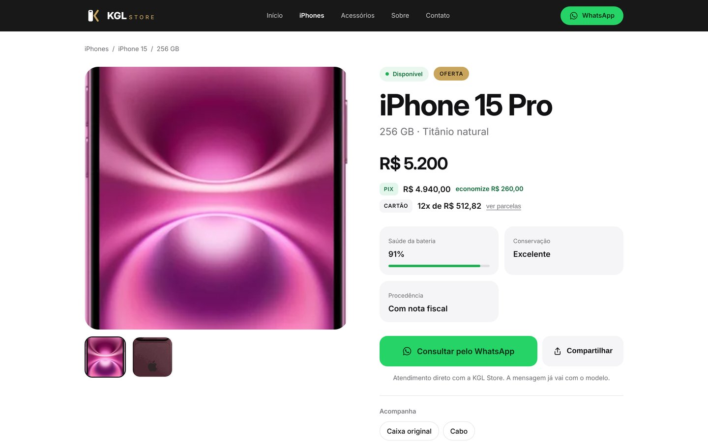
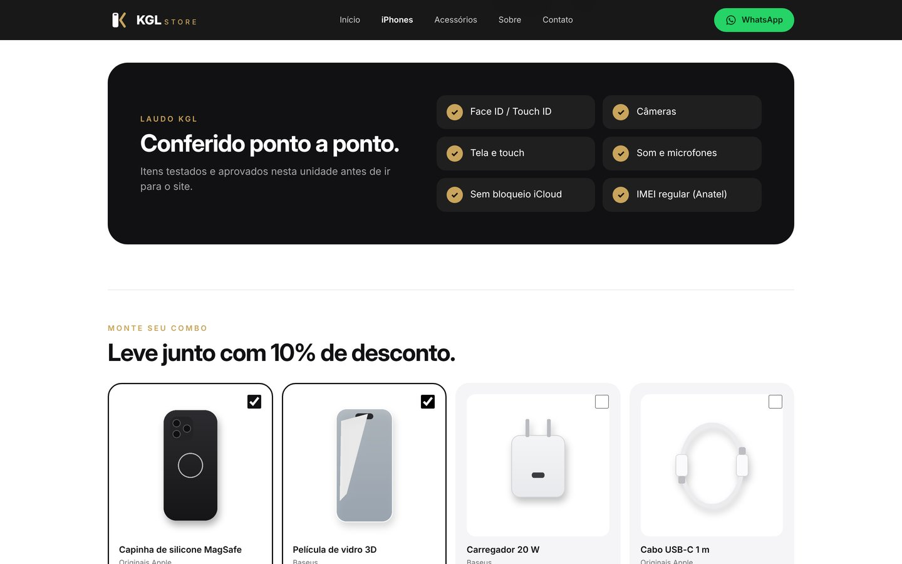
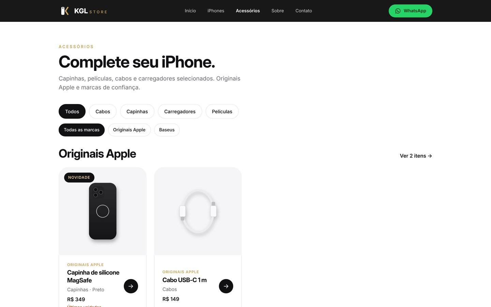
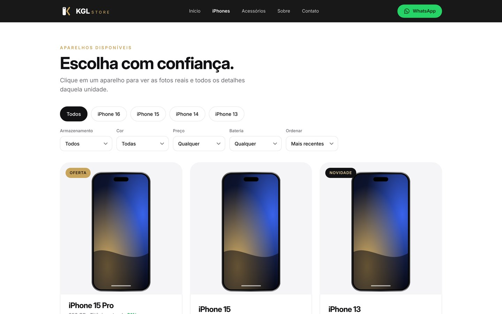
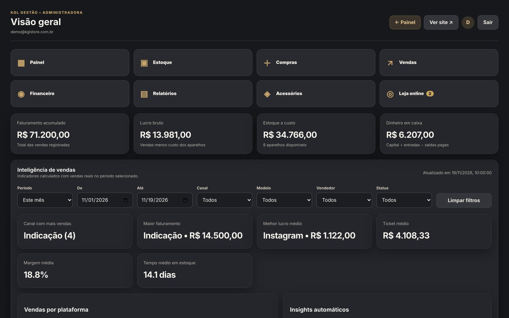
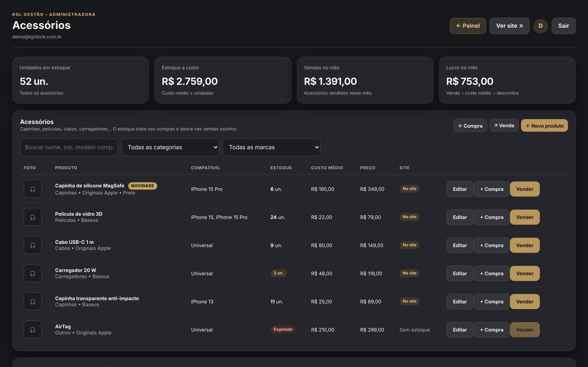
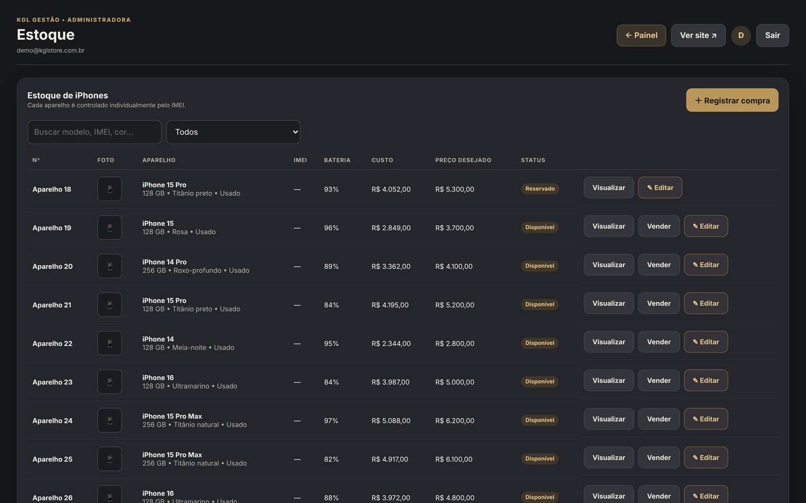
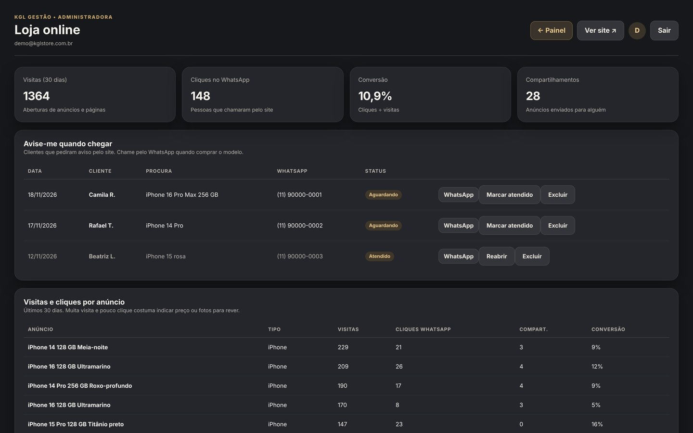
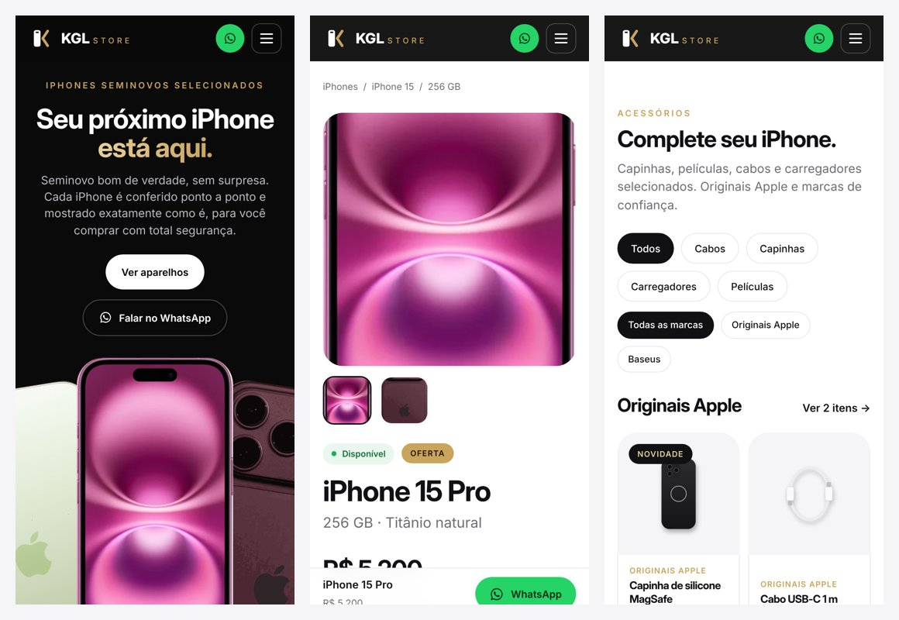
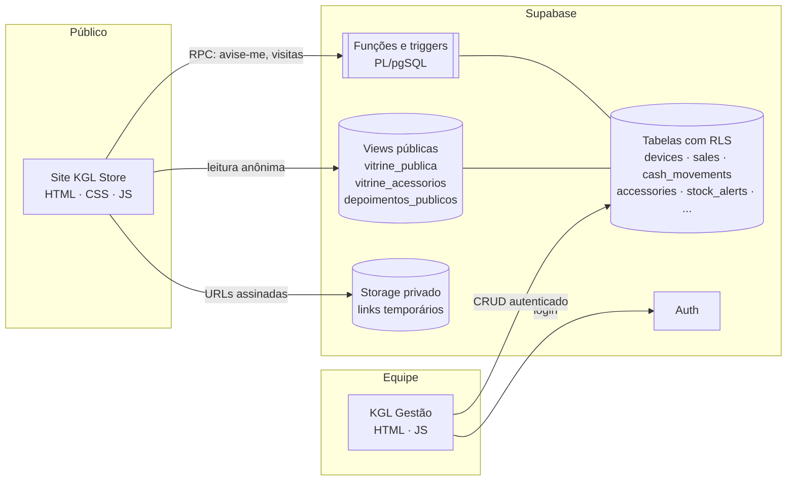

# KGL Store · E-commerce + Sistema de Gestão

> Loja online de iPhones seminovos **integrada em tempo real** a um sistema de gestão próprio.
> Cadastrou a compra no sistema → o aparelho aparece no site com as fotos reais. Vendeu → sai do site sozinho.

🔗 **No ar:** [kglstore.com.br](https://kglstore.com.br)


---

## 💡 A história

O projeto nasceu de uma necessidade real: meu marido começou a comprar e vender iPhones e não encontrou um sistema de gestão que funcionasse do jeito que ele precisava.

Comecei com um painel em HTML que só existia no meu computador. A cada pedido dele, o projeto foi evoluindo até virar dois produtos que conversam entre si:

- **KGL Gestão**: controle de estoque, compras, vendas, caixa, relatórios e indicadores;
- **KGL Store**: o site público da loja, alimentado automaticamente pelo sistema.

Sou engenheira de dados, e desenvolvimento web foi o curso técnico que fiz na ETEC. Este projeto junta as duas coisas: regras de negócio modeladas direto no banco de dados e um front-end feito à mão, sem frameworks.

---

## ✨ Funcionalidades

### Site (KGL Store)
| | |
|---|---|
| 🎬 **Animação de rolagem** no estilo Apple, com inércia suave e respeito a `prefers-reduced-motion` | 📸 **Fotos reais de cada unidade**, separadas das fotos internas de avaliação |
| 💳 **Pix e parcelamento** calculados a partir das taxas da maquininha | ✅ **Laudo técnico**: o que foi testado aparece no anúncio |
| 🧩 **Monte seu combo**: acessórios compatíveis com o modelo, com desconto | 🎧 **Catálogo de acessórios** por marca (Originais Apple, Baseus…) e categoria |
| 🔎 **Filtros**: armazenamento, cor, preço, bateria e ordenação | 🔔 **Avise-me quando chegar**: o cliente deixa o WhatsApp e o pedido cai no sistema |
| ⭐ **Depoimentos** e **destaques** (Oferta / Novidade) gerenciados pelo sistema | 📤 **Compartilhar** (Web Share API com alternativa de copiar o link) |
| 🔐 **Área da loja**: login da equipe mostra o atalho para o sistema | 🌐 **SEO**: Schema.org (Store/Product), sitemap, Open Graph, canonical |

### Sistema (KGL Gestão)
- Painel com **faturamento, lucro, margem, ticket médio, tempo médio em estoque** e desempenho por canal
- Estoque de iPhones com fotos de **estado** (internas) × fotos de **anúncio** (públicas)
- Compras, vendas, caixa, despesas, metas e relatórios exportáveis
- **Acessórios**: estoque e **custo médio ponderado** calculados por triggers; estorno corrige estoque e caixa
- **Loja online**: visitas e cliques no WhatsApp por anúncio, lista do "Avise-me" e depoimentos

| | |
|---|---|
|  |  |
|  |  |
|  |  |
|  |  |



> As telas usam **dados fictícios**.

---

## 🏗️ Arquitetura



### Decisões que valem destacar
- **Segurança por desenho:** o site usa só a chave pública e enxerga apenas *views* com colunas seguras. Custo, IMEI, fornecedor e financeiro ficam fora do alcance. Escrita pública só por funções `SECURITY DEFINER` com validação (`kgl_avise_me`, `kgl_registrar_evento`).
- **Fotos privadas:** o bucket continua privado. Uma política de Storage libera links temporários **apenas** para fotos de anúncios publicados e disponíveis.
- **Regras no banco:** estoque, custo médio e bloqueio de venda sem estoque ficam em triggers, então nenhuma tela consegue deixar os dados inconsistentes.
- **Degradação elegante:** se o banco estiver indisponível, o site usa a lista manual de `js/aparelhos.js`.
- **Performance:** animação só com `transform` e `opacity` (camada de composição), sem `filter` por quadro e com interpolação independente da taxa de quadros (60/120 Hz).

---

## 🛠️ Tecnologias

| Camada | Tecnologia |
|---|---|
| Front-end | HTML5, CSS3 (custom properties, `position: sticky`, grid), **JavaScript puro** |
| Banco de dados | **Supabase / PostgreSQL**: Row Level Security, views, triggers, funções PL/pgSQL |
| Autenticação | Supabase Auth (sessão compartilhada entre site e sistema) |
| Arquivos | Supabase Storage (bucket privado + URLs assinadas) |
| SEO e medição | Schema.org JSON-LD, sitemap.xml, Open Graph, Google Analytics 4, Meta Pixel |
| Testes | **Playwright + pytest** (Supabase simulado, sem internet) |
| Ferramentas | Python (gerador das páginas, Pillow para tratamento de imagens) |
| Hospedagem | HostGator (cPanel) + SSL automático |

---

## 📁 Estrutura

```
site/                 site público (é o conteúdo do public_html)
  js/aparelhos.js     dados da loja e lista manual (alternativa sem banco)
  js/ajustes.js       Pix, taxas por parcela, combo, Analytics/Pixel
  js/conexao.js       URL e chave pública do Supabase
  js/site.js          renderização, filtros, combos, medição, animação
gestao/index.html     KGL Gestão (vai em public_html/gestao/)
supabase/             scripts SQL (rodar na ordem)
ferramentas/          gerador das páginas HTML
testes/               testes de ponta a ponta com Playwright
```

## 🚀 Como rodar

1. Crie um projeto no [Supabase](https://supabase.com).
2. Rode no **SQL Editor**, nesta ordem, `supabase/01-vitrine.sql` e `supabase/02-acessorios-e-melhorias.sql`.
   > Os scripts complementam o esquema base do sistema (lojas, aparelhos, compras, vendas, caixa), que não está incluído neste repositório.
3. Preencha a URL e a chave **publishable** em `site/js/conexao.js` e em `gestao/index.html`.
4. Sirva a pasta `site/` (ex.: `python -m http.server`) ou envie para a hospedagem.

### Testes
```bash
pip install playwright pytest
playwright install chromium
pytest testes/
```

---

## 📄 Licença
Código sob licença MIT. A marca KGL Store e o logotipo pertencem aos seus donos. iPhone é marca registrada da Apple Inc.; a KGL Store é uma loja independente.
